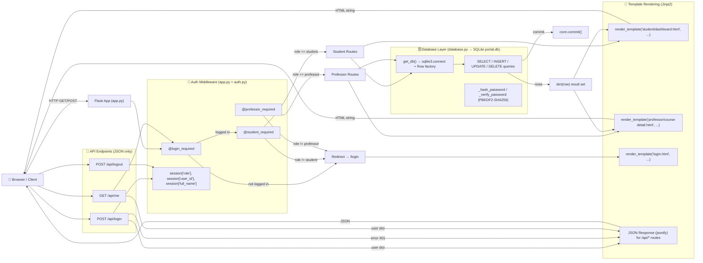

# Student Management Portal

A Flask-based university course management portal where students view their enrolled courses, grades, attendance, announcements, and materials, while professors create and manage courses, enroll students, post announcements, and submit grades.

---

## Tech Stack

| Technology | Layer | Where |
|---|---|---|
| Python 3 | Runtime | `app.py` entry point |
| Flask 3.x | Backend | Routing, templating, sessions, API — `app.py` |
| SQLite | Database | File DB — `database/portal.db` (created by `database.py`) |
| sqlite3 (stdlib) | DB layer | All queries in `database.py` via `get_db()` |
| Jinja2 | Frontend | Server-side HTML — all `templates/*.html` |
| HTML + custom CSS | Frontend | Structure + design system — `templates/`, `static/css/main.css` |
| CSS `@keyframes` | Frontend | Animations — particle drift, card fades, slide-ins, modal/zoom — `static/css/main.css` |
| Inline SVG icons | Frontend | All icons embedded in templates — no icon library |
| Vanilla JS | Frontend | Modals, grade handlers, toasts — `static/js/main.js` + inline blocks |
| PBKDF2-SHA256 (`hashlib`) | Security | Custom hash/verify — `_hash_password`, `_verify_password` in `database.py` |
| Flask sessions (filesystem) | Security | Login state, role, user info — `app.py` `app.secret_key` |
| Google Fonts (Inter) | Frontend | Typography — loaded in `base.html` |

**No frontend framework, no CSS framework, no icon library.** The entire UI is hand-built HTML/CSS/SVG with Jinja2 server-side rendering.

---

## Architecture

### Request–Response Flow



### Routing Table

| URL | Methods | Role | Auth | DB Tables Touched | Response |
|---|---|---|---|---|---|
| `/` | GET | any (logged in) | session | — | Redirect to dashboard by role |
| `/login` | GET, POST | any | none | `users` (SELECT + `_verify_password`) | HTML login page or redirect |
| `/logout` | GET | any | session | — (session cleared) | Redirect to `/login` |
| `/student/dashboard` | GET | student | `@student_required` | `enrollments`, `students`, `users` (stats + enrollments) | HTML dashboard |
| `/student/courses` | GET | student | `@student_required` | `enrollments`, `courses`, `professors`, `users` | HTML course list |
| `/student/courses/<id>` | GET | student | `@student_required` | `courses`, `announcements`, `course_materials` | HTML course detail |
| `/student/profile` | GET | student | `@student_required` | `students`, `users`, `enrollments`, `courses`, `professors` | HTML profile |
| `/professor/dashboard` | GET | professor | `@professor_required` | `courses`, `enrollments`, `announcements` (stats) | HTML dashboard |
| `/professor/courses` | GET | professor | `@professor_required` | `courses`, `enrollments`, `professors`, `users` | HTML course list |
| `/professor/courses/new` | GET, POST | professor | `@professor_required` | `courses` (INSERT), `professors` (SELECT) | GET: form; POST: redirect |
| `/professor/courses/<id>` | GET | professor | `@professor_required` | `courses`, `enrollments`, `all_students`, `announcements`, `course_materials` | HTML course detail |
| `/professor/courses/<id>/edit` | GET, POST | professor | `@professor_required` | `courses` (SELECT / UPDATE) | GET: form; POST: redirect |
| `/professor/courses/<id>/delete` | POST | professor | `@professor_required` | `courses` (DELETE; CASCADE removes enrollments/announcements/materials) | Redirect |
| `/professor/courses/<id>/announcements` | POST | professor | `@professor_required` | `announcements` (INSERT) | Redirect |
| `/professor/courses/<id>/enroll` | POST | professor | `@professor_required` | `enrollments` (INSERT) | Redirect |
| `/professor/enrollments/<id>/remove` | POST | professor | `@professor_required` | `enrollments` (DELETE) | Redirect |
| `/professor/enrollments/<id>/grade` | POST | professor | `@professor_required` | `enrollments` (UPDATE grade) | Redirect |
| `/professor/students` | GET | professor | `@professor_required` | `students`, `users` | HTML student roster |
| `/professor/students/<student_id>` | GET | professor | `@professor_required` | `students`, `users`, `enrollments`, `courses`, `professors` | HTML student detail |
| `/api/login` | POST | any | none | `users` | JSON (user dict or 401) |
| `/api/logout` | POST | any | session | — | JSON `{success: true}` |
| `/api/me` | GET | any | `@login_required` | `users` (SELECT) | JSON (user dict) |
| `/materials/<path>` | GET | any (public) | none | — (static file serve) | File from `static/assets/materials/` |

### Grade Update — End-to-End Trace

```
1. UI: Professor opens /professor/courses/<course_id>
   → Flask GET /professor/courses/<id>
   → professor_course_detail() in app.py
   → get_course_by_id(course_id)         [SELECT c.* + professor name from courses+professors+users]
   → get_course_enrollments(course_id)   [SELECT e.id, student info, grade, attendance FROM enrollments]
   → get_course_announcements(course_id)
   → get_course_materials(course_id)
   → render_template('professor/course-detail.html',
        course, enrollments=[{id, student_id, full_name, grade, attendance, ...}], ...)

2. Template renders each enrollment row:
   
     <form method="POST"
           action="{{ url_for('professor_set_grade', enrollment_id=e.id) }}">
       <input type="hidden" name="enrollment_id" value="{{ e.id }}">
       <select name="grade" onchange="this.form.submit()">
         <option>Set</option>
         <option value="A+" selected>A+</option>
         ...
       </select>
     </form>
   

3. Professor clicks a grade in the dropdown
   → browser fires onchange → this.form.submit()
   → POST to /professor/enrollments/<enrollment_id>/grade
     with body: enrollment_id=<id>&grade=A+

4. Flask routing matches POST /professor/enrollments/<int:enrollment_id>/grade
   → professor_set_grade(enrollment_id) in app.py
   → @professor_required  (checks session['role'] == 'professor')
   → grade = request.form.get('grade', '').strip().upper()
   → validates grade in valid_grades list ["IP","A+",...,"F"]
   → if valid: set_grade(enrollment_id, grade)
        → set_grade() in database.py:
            conn = get_db()
            conn.execute("UPDATE enrollments SET grade = ? WHERE id = ?",
                         (grade, enrollment_id))
            conn.commit()
            conn.close()
   → redirect back to request.referrer  (the course detail page)

5. Browser follows redirect → GET /professor/courses/<course_id>
   → re-renders with updated grade in the enrollment row
   → grade cell now shows e.g. <span class="grade-badge A+">A+</span>
     instead of the dropdown
```

All mutations (grade, enrollment remove, announcement post, course create/edit/delete) use the **Post-Redirect-Get** pattern to avoid duplicate submissions on page refresh.

---

## Features

### Student
- Login with username + password (PBKDF2-SHA256 hashed)
- Dashboard with course count, GPA (computed), average attendance
- My Courses grid — code, name, professor, schedule, room, current grade, attendance bar
- Course detail — announcements, materials list, own grade + attendance
- Personal profile — name, student ID, major, semester, email, enrollment history

### Professor
- Login with username + password
- Dashboard — active course count, total students, announcement count
- **Create courses** — `/professor/courses/new` (code, name, description, credits, semester, schedule, room); auto-assigned to the creating professor
- **List all their courses** — pre-assigned at seed + self-created, in one view
- **Course detail** — enrolled students table (name, ID, major, semester, grade, attendance), inline grade dropdown (IP → A+…F), enroll-student dropdown (filters out already-enrolled), announcements section with "New Announcement" modal, materials list, sidebar with course metadata + grade summary stats
- **Edit course** — `/professor/courses/<id>/edit`
- **Delete course** — confirmation modal, CASCADE removes enrollments/announcements/materials
- **Enroll students** — dropdown from full student roster
- **Remove enrollments** — per-row remove button
- **Set grades** — inline dropdown, validated against the grade scale
- **Post announcements** — modal form per course
- **View all students** — `/professor/students` roster
- **View student detail** — `/professor/students/<student_id>` with that student's full enrollment + grade history

### Auth & Security
- Passwords hashed with PBKDF2-SHA256 (100,000 iterations, random 32-byte salt) — never stored plaintext
- Role-based access: `@login_required`, `@student_required`, `@professor_required` decorators
- Session stored server-side (filesystem), `HttpOnly` cookie
- API endpoints return JSON 401/403 for unauthenticated/unauthorized requests; HTML routes redirect to login
- `SECRET_KEY` configurable via environment variable

### Seed Data (fresh DB)
- 8 students across CS, Mathematics, Electrical Engineering (semesters 1–4)
- 10 courses: CS301, CS201, CS350 (Machine Learning), CS410 (Capstone), CS101, MA250, MA300, MA150, EE310, EE220
- 7 announcements, 7 course materials (PDFs + zip)
- Mixed grade states: some graded (A, A-, B+, B, C+), some IP (in progress)

---

## Demo Credentials

| Role | Username | Password |
|---|---|---|
| Professor — CS (Dr. Shereen Rahman) | `srahman` | `prof123` |
| Professor — Math (Prof. James Mitchell) | `jmitchell` | `prof123` |
| Professor — EE (Dr. Anita Kumar) | `akumar` | `prof123` |
| Student (Aav Singh, S001) | `as123` | `as123` |

---

## Project Structure

```
student_portal/
├── app.py                 # Flask app — routes, context processors, Jinja filters
├── auth.py                # Login/logout + @login_required / @student_required / @professor_required
├── database.py            # DB init, seed data, all query/insert/update functions
├── requirements.txt       # Python dependencies
├── database/
│   └── portal.db          # SQLite DB (created on first run if missing)
├── static/
│   ├── css/
│   │   └── main.css       # Full design system + particle field animations
│   └── js/
│       └── main.js        # Shared UI helpers
└── templates/
    ├── base.html          # Shared layout: sidebar, topbar, particle field, modals shell
    ├── login.html         # Login page (standalone)
    ├── student/
    │   ├── dashboard.html
    │   ├── courses.html
    │   ├── course-detail.html
    │   └── profile.html
    └── professor/
        ├── dashboard.html
        ├── courses.html
        ├── course-detail.html
        ├── manage-course.html
        ├── students.html
        └── student-detail.html
```

---

## Running Locally

```bash
# 1. Install dependencies
pip install -r requirements.txt

# 2. Start the server (creates database/portal.db + seeds on first run)
python3 app.py

# 3. Open the portal
#    http://127.0.0.1:5000
```

The first run creates `database/portal.db` and seeds it with the demo data above. To reset the database, delete `database/portal.db` and restart the server.

---

## Deployment Note

This is a long-lived Flask server. For deployment:

- **VPS / Render / Railway / Heroku-style:** add a `Procfile` (`web: gunicorn app:app`) and deploy with gunicorn.
- **Vercel:** Vercel's serverless model does not run a long-lived Flask server directly — you'd need a serverless adapter (e.g. wrapping as a Vercel serverless function) or deploy elsewhere. The codebase itself is unchanged; only the runtime wrapper differs.

The `requirements.txt` and project structure are ready to push to GitHub as-is.